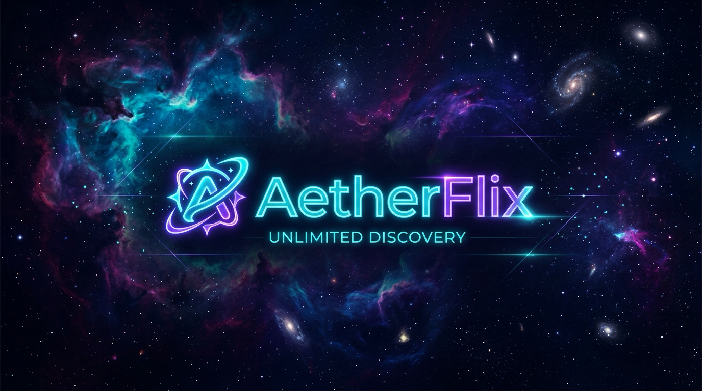

# AetherFlix 🌌

[](https://android.com/tv/)
[](https://developer.samsung.com/smarttv)
[](https://docker.com)
[](LICENSE)

**AetherFlix** is an open-source, universal streaming platform tailored for **Smart TVs** (**Android TV**, **Google TV**, **Fire TV**, and **Samsung Smart TVs running Tizen OS**), as well as standard web browsers and self-hosted homelabs.

Stream any Movie, TV Series, or Anime with zero ads, rich TMDB metadata, and a modern **10-foot living room UI** powered by full TV remote D-Pad spatial navigation.



---

## ✨ Features

- 📺 **Universal Smart TV Support:**
  - **Android TV / Google TV / Fire TV:** Pre-configured with Capacitor for native Android Leanback TV launcher support and high-performance WebViews.
  - **Samsung Smart TV (Tizen OS):** Built-in Tizen `config.xml` package generator that compiles directly to `.wgt` for Samsung Smart Hub.
- 🎮 **10-Foot Spatial Remote Navigation:**
  - Full directional D-Pad control (`Up`, `Down`, `Left`, `Right`, `OK/Select`, `Back`).
  - Seamless support for TV hardware back buttons (Tizen Return key code 10009 and Android Back key).
  - Living-room optimized focus rings with vibrant scale animations and overscan safe-area padding.
- 🐳 **Self-Hostable Backend:** Run the AetherFlix backend server on Docker, Coolify, Dokploy, Portainer, or any VPS/NAS, and connect your TV apps across your home network.
- 🍿 **Rich TMDB Metadata & Anime Support:** Posters, backdrops, ratings, synopsis, episode selectors, AniList integration, and subtitle search (Wyzie / SubDL).
- 🛡️ **Zero Ads & Trackers:** Clean video playback without annoying popups or redirects.

---

## 🎮 TV Remote Controls

| Remote Button | Action |
| :--- | :--- |
| **D-Pad (Arrows)** | Move focus between movie cards, rows, and menus |
| **Enter / OK / Select** | Open focused title, select episode, or click button |
| **Back / Return / Exit** | Dismiss modal, close player overlay, or navigate back |
| **Red Button / F1** | Quick open search |
| **Play / Pause / Media** | Controls video playback |

---

## 🚀 Getting Started

### 1. Web & Docker Mode (Run on PC / Homelab)

#### Using Docker Compose (Recommended)
```bash
# 1. Clone the repository
git clone https://github.com/Hamza-Boulila/aetherflix.git
cd aetherflix

# 2. Add your free TMDB API Read Access Token in .env
cp .env.example .env
# Edit .env and set TMDB_API_KEY=...

# 3. Start the server
docker compose up -d
```
Visit **http://localhost:3000** in your browser.

#### Running locally with Node.js
```bash
npm install
npm run build
npm start
```

---

## 📱 Building for Android TV / Google TV / Fire TV

> **⚡ Quick Build (All Smart TV Platforms):**
> Run `npm run build:tv:all` to package both the signed **Android TV APK** (`dist/AetherFlix.apk`) and the **Samsung Tizen OS Widget** (`dist/AetherFlix.wgt`) in one command.

AetherFlix includes an automated setup script that configures Capacitor with Android TV Leanback launcher support, hardware feature flags, cleartext traffic permissions, and TV banner icons.

### Prerequisites
- Node.js 18+
- Android Studio & Android SDK

### Steps to Build the Android TV Release APK:
```bash
# 1. Install dependencies
npm install

# 2. Build the signed Release APK (automatically configures Leanback & TV WebView)
npm run build:android:release
```

The generated release APK is saved directly to:
```text
dist/AetherFlix.apk
```

### Sideloading onto Android TV, Google TV, or Fire TV:
1. On your Android TV / Google TV / Fire TV: Go to **Settings** → **Device / About** → click **Build** 7 times to enable **Developer Options**.
2. Under Developer Options, enable **USB Debugging** (or **Network ADB Debugging**).
3. Connect your computer to your TV over WiFi and install:
   ```bash
   adb connect <YOUR_TV_IP>:5555
   adb install -r dist/AetherFlix.apk
   ```
*(Alternatively, copy `dist/AetherFlix.apk` to a USB drive or host it on your local network to open with the **Downloader** app on Fire TV).*

---

## 📺 Building for Samsung Smart TV (Tizen OS)

AetherFlix includes a Tizen packager that creates an installable `.wgt` (Tizen widget) directly from your build bundle.

### Prerequisites
- Tizen Studio & TV Extension (for SDB command-line tool)
- Python 3 (installed by default on macOS & Linux)

### Steps to Package:
```bash
# 1. Package the Tizen widget
npm run build:tizen
```
This produces **`dist/AetherFlix.wgt`**.

### Installing on your Samsung TV:
1. Ensure your Samsung TV and computer are on the same Wi-Fi network.
2. On your Samsung TV: Go to **Apps** → press `1 2 3 4 5` on your remote to open **Developer Mode**.
3. Toggle **Developer Mode ON**, enter your computer's IP address as the **Host PC IP**, and restart your TV.
4. From your computer's terminal:
   ```bash
   sdb connect <YOUR_TV_IP>
   sdb install dist/AetherFlix.wgt
   ```
5. AetherFlix will appear in your Samsung Smart Hub app bar!

---

## 🔗 Connecting the TV App to your Backend Server

When running AetherFlix as a sideloaded app on a TV, it connects to your self-hosted AetherFlix server on your local network:

1. Launch AetherFlix on your TV.
2. Open **Settings** (gear icon in sidebar).
3. Scroll to **Smart TV & Remote Server**.
4. Enter your backend server's local IP (e.g. `http://192.168.1.100:3000`).
5. Click **Test Connection** → **Save Server**.

---

## 🙏 Credits & Acknowledgements

- **[Streambert](https://github.com/truelockmc/streambert)** by **[@truelockmc](https://github.com/truelockmc)** — Immense credit and special thanks to the original Streambert project for providing the foundational streaming architecture, UI design, player integration, and media handling upon which AetherFlix is built and extended with 10-foot D-Pad remote navigation and universal Smart TV support (Android TV, Google TV, Fire TV, and Samsung Tizen OS).
- **[TMDB (The Movie Database)](https://www.themoviedb.org/)** — For comprehensive movie, television, and cast metadata.
- **[Capacitor](https://capacitorjs.com/)** — Cross-platform runtime powering the native Android TV & Leanback launcher support.

---

## 📄 License
This project is licensed under the **GNU General Public License v3.0 (GPL-3.0)** in accordance with the upstream Streambert license.
